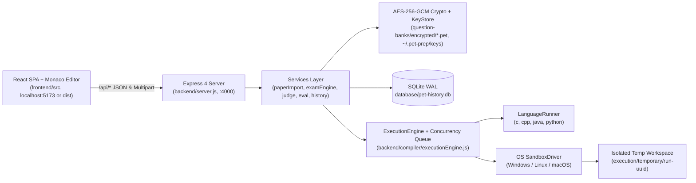
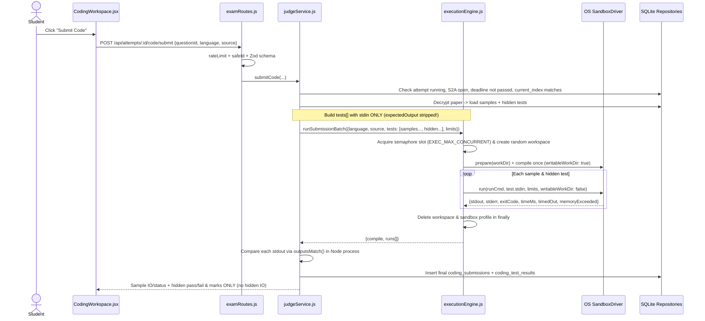

# Architecture

## System Overview

PET Prep uses a split client-server local architecture where the Express backend is the single source of truth for paper decryption, timers, navigation state, violation limits, sandboxed code execution, and scoring.

## Component Responsibilities

| Layer | Modules | Responsibilities |
| --- | --- | --- |
| **Frontend UI** | `frontend/src/pages/`, `frontend/src/components/`, `frontend/src/services/` | Landing/prompt copy, `.petdraft`/`.pet` upload UI, exam rules & fullscreen gate, forward-only MCQ/snippet/coding exam workspace, client timer synced from `serverNow`, results/review dashboard, history/analytics/exports, settings, syllabus. |
| **API Middleware & Validation** | `server.js`, `errorHandler.js`, `rateLimit.js`, `routeParams.js` | Helmet CSP (`'self' blob:` workers), origin-restricted CORS, 2 MB JSON limit, 25 MB multipart limit, Zod param/body checks, sliding-window rate limiter on `/api/attempts/:id/code/*`. |
| **Paper Import & Crypto** | `questionValidator.js`, `paperImportService.js`, `codingVerifier.js`, `encryptionService.js`, `decryptionService.js`, `keyStore.js` | Merges full or A/B/C `.petdraft` files, enforces 67-Q / 100-mark rules, verifies `referenceSolution` and `"AUTO"` tests inside the sandbox, encrypts with AES-256-GCM (`PET1` header + 96-bit nonce). |
| **Exam Engine & Judge** | `examEngine.js`, `judgeService.js` | Enforces sequential `S1` -> `S2` -> `S2A` locking, server deadlines, forward-only index updates, violation tracking, draft autosave, and coding grading. |
| **Scoring & History** | `evaluationService.js`, `resultService.js`, `historyService.js` | Computes golden breakdowns, enforces post-completion review gating, aggregates weak-topic analytics (`>= 3` attempted threshold), compares 2–4 attempts, and exports sanitized JSON/CSV. |
| **Database Layer** | `database.js`, `repositories.js`, `schema.sql` | Manages SQLite connections (WAL, `foreign_keys=ON`), migrations, online `.backup()` snapshots, and parameterized repositories. |
| **Execution Engine** | `executionConfig.js`, `executionEngine.js`, `languageRunner.js`, `compilerDetector.js`, `sandbox/*` | Validates env caps, queues jobs, compiles once per submission, feeds test `stdin` into OS-native sandboxes, tracks runtime/memory, kills process trees, and cleans temp workspaces. |

## Request Flow: Student Submits Code

## Execution Engine & Hidden Test Isolation

1. **Public interface preserved:** Both `judgeService.js` and `codingVerifier.js` call `runSubmission` and `runSubmissionBatch`.
2. **Bounded Concurrency Queue:** `createConcurrencyQueue(EXEC_MAX_CONCURRENT)` limits active OS sandbox runs so simultaneous submissions queue cleanly without exhausting CPU/RAM.
3. **Hidden Test Privacy:** Expected outputs (`t.expectedOutput`) and input metadata (`t.id`, `t.marks`) stay strictly inside `judgeService.js` (server Node memory). `runSubmissionBatch` receives only `{ stdin }`, feeds it exclusively over standard input pipes (`stdio: ['pipe', 'pipe', 'pipe']`), and never passes tests via workspace files, CLI arguments, or environment variables.
4. **Workspace Lifecycle & Sweeper:** Each batch gets an isolated directory (`execution/temporary/run-<uuid>/`). `finally` always calls `driver.cleanup()` and removes the workspace directory; startup cleanup (`cleanupStaleWorkspaces`) and a 5-minute periodic sweeper prune stale workspaces older than 10 minutes.
5. **Diagnostics & Fail-Closed Design:** `detectCompilers()` probes host compilers plus `resolveActiveSandbox()` at startup and on demand via `GET /api/health/diagnostics` and `GET /api/settings/compilers`. If the host OS sandbox fails detection and `PET_ALLOW_INSECURE_EXECUTION` is `false` (default), execution refuses with `503 SANDBOX_UNAVAILABLE`.
