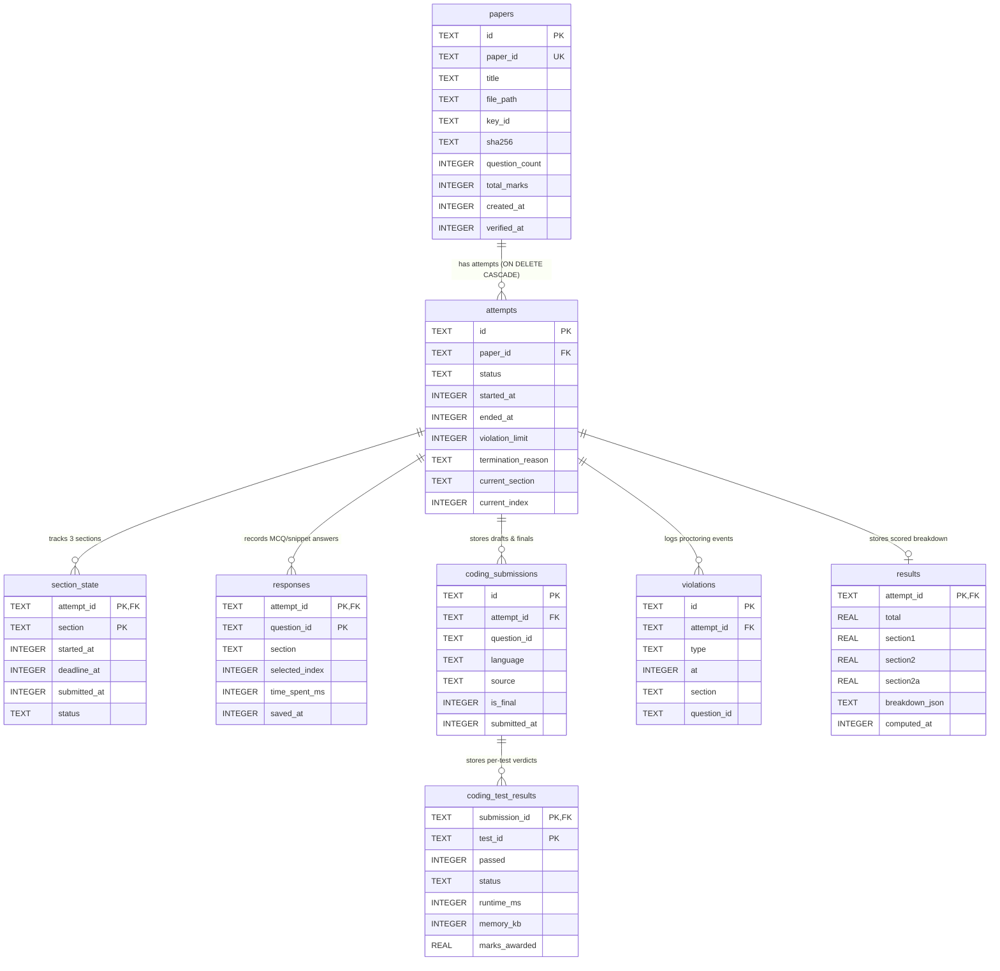

# Database Documentation

PET Prep persists state in an embedded SQLite database located at `<DATA_DIR>/database/pet-history.db` (configured via [database.js](file:///d:/CCC/Pet%20application/backend/database/database.js) and [schema.sql](file:///d:/CCC/Pet%20application/backend/database/schema.sql)). At connection open, `PRAGMA journal_mode = WAL` (for file databases) and `PRAGMA foreign_keys = ON` are always enabled.

## Entity-Relationship Diagram

Unlinked utility tables:
- `settings (key TEXT PRIMARY KEY, value TEXT NOT NULL)`
- `migrations (version INTEGER PRIMARY KEY, name TEXT NOT NULL, applied_at INTEGER NOT NULL)`

## Tables & Constraints

### `settings`
| Column | Type | Constraints | Description |
| --- | --- | --- | --- |
| `key` | `TEXT` | `PRIMARY KEY` | Setting key (e.g., `violation_limit`) |
| `value` | `TEXT` | `NOT NULL` | Stringified setting value |

### `papers`
| Column | Type | Constraints | Description |
| --- | --- | --- | --- |
| `id` | `TEXT` | `PRIMARY KEY` | Internal UUID |
| `paper_id` | `TEXT` | `NOT NULL UNIQUE` | External paper identifier (from `.petdraft`) |
| `title` | `TEXT` | `NOT NULL` | Display title |
| `file_path` | `TEXT` | `NOT NULL` | Path to encrypted `.pet` package on disk |
| `key_id` | `TEXT` | `NOT NULL` | Encryption key ID used for AES-256-GCM |
| `sha256` | `TEXT` | `NOT NULL` | Ciphertext SHA-256 hex digest |
| `question_count` | `INTEGER` | `NOT NULL` | Fixed at `67` |
| `total_marks` | `INTEGER` | `NOT NULL` | Fixed at `100` |
| `created_at` | `INTEGER` | `NOT NULL` | Epoch ms timestamp |
| `verified_at` | `INTEGER` | Nullable | Reference-solution verification timestamp |

### `attempts`
| Column | Type | Constraints | Description |
| --- | --- | --- | --- |
| `id` | `TEXT` | `PRIMARY KEY` | Attempt UUID |
| `paper_id` | `TEXT` | `NOT NULL REFERENCES papers(id) ON DELETE CASCADE` | Parent paper ID |
| `status` | `TEXT` | `DEFAULT 'not_started' CHECK IN ('not_started','running','completed','terminated','abandoned')` | Lifecycle state |
| `started_at` | `INTEGER` | Nullable | Epoch ms when Section 1 started |
| `ended_at` | `INTEGER` | Nullable | Epoch ms when completed/terminated |
| `violation_limit` | `INTEGER` | `NOT NULL DEFAULT 3` | Configured limit (`3` or `5`) |
| `termination_reason` | `TEXT` | Nullable | Reason if terminated |
| `current_section` | `TEXT` | `CHECK NULL OR IN ('S1','S2','S2A')` | Currently open section |
| `current_index` | `INTEGER` | `NOT NULL DEFAULT 0` | Zero-based cursor inside `current_section` |

### `section_state`
| Column | Type | Constraints | Description |
| --- | --- | --- | --- |
| `attempt_id` | `TEXT` | `NOT NULL REFERENCES attempts(id) ON DELETE CASCADE` | Composite PK part 1 |
| `section` | `TEXT` | `NOT NULL CHECK IN ('S1','S2','S2A')` | Composite PK part 2 |
| `started_at` | `INTEGER` | Nullable | Server epoch ms start |
| `deadline_at` | `INTEGER` | Nullable | Authoritative server deadline ms |
| `submitted_at` | `INTEGER` | Nullable | Submission/expiry timestamp |
| `status` | `TEXT` | `DEFAULT 'locked' CHECK IN ('locked','open','submitted','expired')` | State machine status |

### `responses`
| Column | Type | Constraints | Description |
| --- | --- | --- | --- |
| `attempt_id` | `TEXT` | `NOT NULL REFERENCES attempts(id) ON DELETE CASCADE` | Composite PK part 1 |
| `question_id` | `TEXT` | `NOT NULL` | Composite PK part 2 (e.g., `S1-APT-01`) |
| `section` | `TEXT` | `NOT NULL CHECK IN ('S1','S2','S2A')` | Section identifier |
| `selected_index` | `INTEGER` | `CHECK NULL OR (0..3)` | Chosen option (`null` if unanswered) |
| `time_spent_ms` | `INTEGER` | `NOT NULL DEFAULT 0` | Accumulated answer duration |
| `saved_at` | `INTEGER` | `NOT NULL` | Save timestamp |

### `coding_submissions` & `coding_test_results`
- **`coding_submissions`:** `id TEXT PK`, `attempt_id TEXT FK CASCADE`, `question_id TEXT`, `language TEXT CHECK IN ('c','cpp','java','python')`, `source TEXT`, `is_final INTEGER CHECK IN (0,1)` (`0`=draft, `1`=final submission), `submitted_at INTEGER`.
- **`coding_test_results`:** Composite PK `(submission_id FK CASCADE, test_id)`, `passed INTEGER (0|1)`, `status TEXT CHECK IN ('pass','fail','tle','rte','ce')`, `runtime_ms INTEGER`, `memory_kb INTEGER`, `marks_awarded REAL`.

### `violations` & `results`
- **`violations`:** `id TEXT PK`, `attempt_id TEXT FK CASCADE`, `type TEXT CHECK IN ('tab_hidden','fullscreen_exit','window_blur','devtools','copy_paste')`, `at INTEGER`, `section TEXT`, `question_id TEXT`.
- **`results`:** `attempt_id TEXT PK FK CASCADE`, `total REAL`, `section1 REAL`, `section2 REAL`, `section2a REAL`, `breakdown_json TEXT`, `computed_at INTEGER`.

## Indexes

- `idx_attempts_paper_id` ON `attempts(paper_id)`
- `idx_responses_attempt_id` ON `responses(attempt_id)`
- `idx_violations_attempt_id` ON `violations(attempt_id)`
- `idx_coding_submissions_attempt_id` ON `coding_submissions(attempt_id)`

## Migrations, Seeding & Backups

- **Migrations:** Automatically executed on startup inside `openDatabase()` (`runMigrations(db)` in [database.js](file:///d:/CCC/Pet%20application/backend/database/database.js)), applying Version `1` (`initial_contract_c_schema`) from `schema.sql`.
- **Seed Data:** **None.** The application starts cleanly with zero sample papers, zero attempts, and zero analytics data.
- **Backups:** `backupDatabase(db)` uses `better-sqlite3`'s online `.backup()` API to snapshot to `<DATA_DIR>/database/backups/pet-history-<timestamp>-<rand>.db` on server startup, on attempt completion, or via `POST /api/settings/backup`, keeping the latest 10 snapshots.
